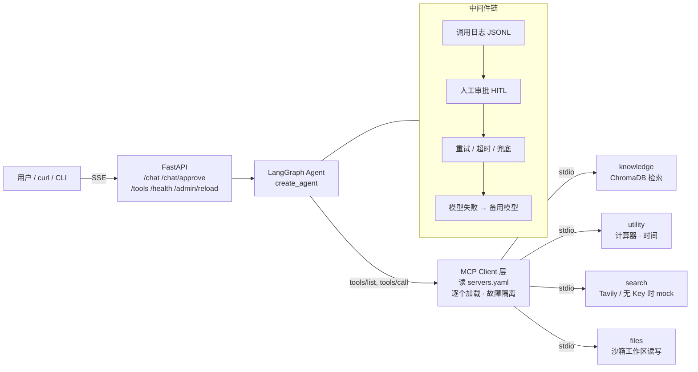

# 基于 MCP 协议的可插拔工具 Agent 平台

一个**工具与 Agent 完全解耦**的 ReAct Agent 平台：所有工具都以 MCP Server 的形式独立运行，
Agent 在启动时通过 MCP 协议**动态发现**工具。接入新工具只需写一个 MCP Server 并在
`config/servers.yaml` 里登记一行，**Agent 代码一行不改**（见 [演示 1](#演示-1不改-agent-代码接入新工具)）。

- **协议层**：MCP Python SDK 2.x（stdio），4 个独立 Server：知识库 / 计算与时间 / 联网搜索 / 文件读写
- **Agent 层**：LangChain `create_agent` + LangGraph，中间件实现人工审批、重试降级、步数上限、调用日志
- **服务层**：FastAPI + SSE 流式输出，支持审批中断与恢复、管理接口热重载
- **评测**：24 条用例 × 3 轮，3 个带公式的指标，工具调用准确率 **98.6%**、任务完成率 **100%**、异常降级成功率 **100%**

---

## 架构



| 层 | 关键文件 | 职责 |
|---|---|---|
| MCP Servers | `servers/*_server.py` | 每个工具一个进程，Agent 只看得到它们的名字、描述和参数 schema |
| 工具注册表 | `config/servers.yaml` | 声明有哪些 Server、怎么启动；服务名即工具名前缀（`utility` → `utility_calculate`） |
| MCP Client | `app/mcp_client.py` | 每个 Server 单独加载、30 秒超时，**一个 Server 挂掉不影响其他** |
| Agent 策略 | `config/policy.yaml` | 系统提示词、步数上限、重试参数、高危工具清单——**像代码一样版本管理** |
| Agent | `app/agent.py` | 组装模型 + 工具 + 中间件；文件中**不出现任何工具名**（有单测守护） |
| 韧性 | `app/resilience.py` | 传输错误重试（指数退避）、单次调用超时、业务错误转为模型可读的错误消息、模型失败切换备用模型 |
| 日志 | `app/tool_logger.py` | 每次工具调用一行 JSONL：参数、是否成功、重试次数、耗时、结果摘要 |
| API | `app/api.py` | SSE 流式、审批恢复、每会话加锁、管理员令牌保护的热重载 |

### 设计要点

- **工具与 Agent 解耦**：Agent 通过 MCP `tools/list` 获取工具；提示词里不写工具名，靠工具自身的描述让模型选择。
- **审批是"失败即拒绝"（fail-closed）**：`policy.yaml` 中的高危工具（联网搜索会把用户输入发到外部、写文件会改动磁盘）在执行前暂停，只有显式 `approve` 才执行；启动时校验清单里的工具名，拼写错误直接报错，避免"以为有审批其实没有"。
- **分层降级，永不崩溃**：
  - 工具进程挂了/卡住 → 重试 2 次（指数退避）→ 仍失败则返回错误消息，模型据此告知用户哪部分信息拿不到
  - 参数错误等业务错误 → 不重试，直接让模型看到错误并修正
  - 主模型不可用 → 自动切换备用模型 → 仍不可用则返回友好提示
  - 某个 MCP Server 启动失败 → 其余工具照常可用，`/health` 报告故障
- **配置全部外置**：模型名、Base URL、Key 都来自 `.env`（OpenAI 兼容接口，换任意厂商不改代码）；密钥只存 `.env`，代码中零硬编码。

---

## 快速开始

环境：Python 3.11（Windows / PowerShell 下开发，Linux 同样可用）。

```powershell
python -m venv .venv
.venv\Scripts\Activate.ps1          # Linux: source .venv/bin/activate
pip install -r requirements.txt     # 所有版本均已锁定

Copy-Item .env.example .env         # 然后填入 API_KEY 等
python -m scripts.check_env         # 自检：配置、模型、工具调用、Embedding
python -m scripts.ingest            # 把 data/docs/ 的制度文档切块写入 ChromaDB
python -m scripts.inspect_tools     # 列出所有 MCP Server 暴露的工具
```

`.env` 主要配置项（完整列表见 `.env.example`）：

| 变量 | 说明 |
|---|---|
| `MODEL_NAME` / `API_KEY` / `BASE_URL` | 任意 OpenAI 兼容模型（开发时用阿里百炼 `qwen3.7-plus`） |
| `FALLBACK_MODEL_NAME` | 可选，主模型失败时的备用模型 |
| `LLM_EXTRA_BODY` | 可选，厂商专有参数，如 `{"enable_thinking": false}` |
| `EMBEDDING_MODEL` / `EMBEDDING_DIM` | Embedding 模型与维度（换模型后会强制重建索引） |
| `TAVILY_API_KEY` | 可选；不填时搜索工具返回明确标注"非真实信息"的 mock 结果 |
| `ADMIN_TOKEN` | 可选；不填时热重载接口关闭 |

### 运行

```powershell
python -m scripts.cli_chat                 # 命令行对话（/tools /new /exit）
uvicorn app.api:app --port 8000            # HTTP 服务
python -m pytest tests -q                  # 91 个测试，不需要网络和 API Key
```

### API

| 方法 | 路径 | 说明 |
|---|---|---|
| GET | `/health` | 哪些 MCP Server 加载成功 / 失败 / 被禁用 |
| GET | `/tools` | Agent 当前可用的工具 |
| POST | `/chat` | `{"message", "thread_id"?}` → SSE 流 |
| POST | `/chat/approve` | `{"thread_id", "decisions": [{"type": "approve"/"reject"}]}` → 恢复被审批暂停的回合 |
| POST | `/admin/reload` | 请求头 `X-Admin-Token`；重读 `servers.yaml` 和 `policy.yaml`，不重启服务 |

SSE 事件类型：`thread`、`token`、`tool_call`、`tool_result`、`approval_required`、`done`、`error`。

---

## 演示

### 演示 1：不改 Agent 代码接入新工具

文件读写工具（`servers/file_server.py`）是在 Agent 完成之后才加入的。接入它的提交只包含：

```text
servers/file_server.py        # 新的 MCP Server
config/servers.yaml           # 登记 4 行
config/policy.yaml            # 把 files_write_file 列为高危工具
tests/test_file_server.py
```

`git show --stat 974b4dc` 可以验证：**`app/` 目录没有任何改动**。重启（或调用 `/admin/reload`）后
`/tools` 里就出现了 `files_list_files` / `files_read_file` / `files_write_file`。

### 演示 2：热插拔，不重启服务

```powershell
# 在 servers.yaml 里给 files 加 enabled: false，然后：
curl.exe -X POST http://127.0.0.1:8000/admin/reload -H "X-Admin-Token: <你的令牌>"
# -> {"removed": ["files_list_files", "files_read_file", "files_write_file"], ...}  9 → 6 个工具
# 删掉 enabled: false 再 reload -> 6 → 9 个工具
```

新配置有错误（比如 YAML 写坏）时返回 422，**旧的 Agent 继续服务**，已有会话记忆不丢失。

### 演示 3：人工审批

问"帮我把北京的住宿标准写到 notes/beijing.md"，Agent 先检索制度，然后在调用 `files_write_file`
前暂停，SSE 推送 `approval_required`；调用 `/chat/approve` 选择 approve 才真正写入，reject 则 Agent
告知用户未执行。

### 演示 4：降级

- 停掉知识库 Server：`/health` 显示它加载失败，其他工具照常工作，问制度问题时 Agent 明确说明"知识库暂不可用"，不编造。
- 把 `MODEL_NAME` 改成不存在的模型：自动切到 `FALLBACK_MODEL_NAME` 回答。

---

## 评测

```powershell
python -m eval.run_eval --repeat 3          # 全部用例跑 3 轮，生成 eval/report.md
python -m eval.run_eval --only ret-07 exc-06
```

**用例**（`eval/eval_cases.jsonl`，24 条，4 类）：

| 类别 | 数量 | 覆盖内容 |
|---|---|---|
| calc | 6 | 四则运算、中文符号（×÷）、日期时间 |
| retrieval | 8 | 单文档检索、多轮对话、**跨文档引用**、知识库里没有的问题（应拒答） |
| search | 4 | 联网搜索；无 Key 时必须说明结果不可用，不得把 mock 当真 |
| exception | 6 | 除零、非法输入、不存在的文档、路径穿越读 `.env`、审批被拒、**知识库 Server 宕机** |

**指标**（24 条用例 × 3 轮 = 72 次运行，最终结果见 [`eval/report.md`](eval/report.md)）：

| 指标 | 公式 | 结果 |
|---|---|---|
| 工具调用准确率 | 调用了所有期望工具且未调用任何禁用工具的运行数 / 声明了期望或禁用工具的运行数 | **71/72 = 98.6%** |
| 任务完成率 | 未崩溃且最终答案通过关键词检查（必含 / 任一 / 禁含）的运行数 / 全部运行数 | **72/72 = 100%** |
| 异常降级成功率 | 异常类中未崩溃、给出非空答案且通过检查的运行数 / 异常类运行数 | **18/18 = 100%** |

**评测方法上的几点**：

- **重复 3 轮**：`temperature=0` 也不能保证输出完全一致，单轮结果会波动。
- **环境隔离**：每次评测使用空的临时工作区，结果不受开发者本机文件影响（曾因此出现过一次误判）。
- **区分环境故障**：模型 API 不可达导致的失败会自动重跑并在报告中计数，**但不从分母中剔除**。

**迭代过程**：首轮评测发现 2 类失败——
1. 跨文档引用题只检索了第一篇文档 → 在 `policy.yaml` 增加"遇到引用就继续查"的规则，**只改配置不改代码**，复测 3/3 通过；
2. 知识库宕机题的答案来自演示时遗留的笔记文件 → 定位为评测环境污染，改为每次评测隔离工作区。

---

## 已知局限

- **提示词约束不是硬保证**：知识库宕机时，模型偶尔仍会去联网搜索公司内部制度（3 轮中 1 次），违反了提示词规则。
  线上有人工审批作为第二道防线（联网搜索是高危工具）；更彻底的做法是在中间件层按场景做确定性的工具白名单。
- **每次工具调用启动一个 Server 进程**：stdio 方式实现简单、隔离好，但检索类问题会多出进程启动开销；可改为长连接或 HTTP 传输。
- **会话记忆在内存中**（`InMemorySaver`）：服务重启后丢失；生产环境应换成 SQLite/Postgres checkpointer。
- **忠实性尚未单独评测**：曾观察到模型在写笔记时加入了文档里没有的推断（"北京属于一类城市"）；当前关键词检查发现不了这类问题，后续可加入基于引用的忠实性指标。

## 技术栈

Python 3.11 · MCP Python SDK 2.3 · LangChain 1.4（`create_agent`、`langchain.mcp`）· LangGraph 1.2 ·
FastAPI（原生 SSE）· ChromaDB · pydantic-settings · pytest
